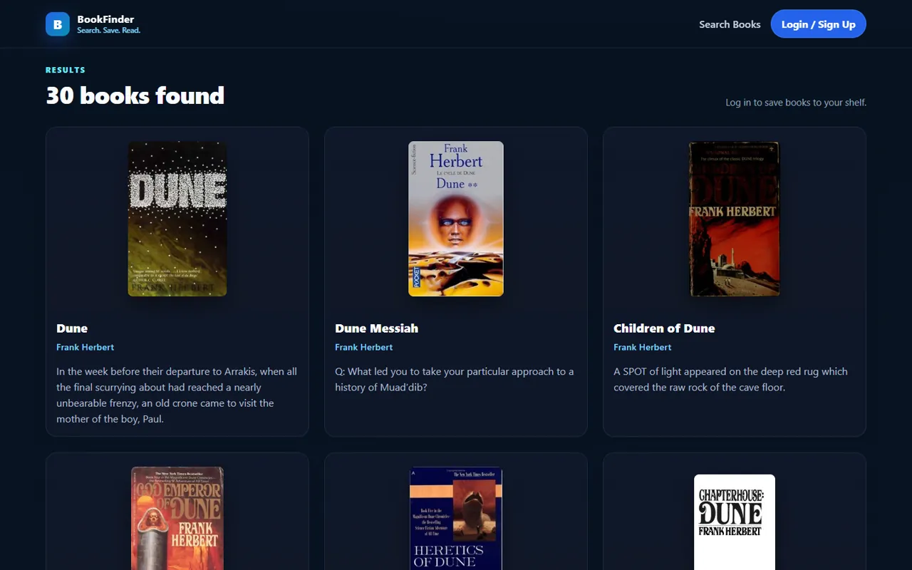

# 📚 MERN Book Search Engine

> A GraphQL‑powered Google Books search & personal library app built on the MERN stack.  
> Search for books, sign up/log in, save favorites, and manage your reading list—all deployed on Render with MongoDB Atlas.

---

## 🔗 Live Demo & Repo +

- **Live Demo:** https://one8-mern-book-search-engine.onrender.com
- **GitHub Repo:** https://github.com/PHTMGatt/18-MERN-Book-Search-Engine 

---

## 🛠 Tech Stack

| Layer      | Technology                        |
| ---------- | --------------------------------- |
| Front‑end  | React, Apollo Client, TypeScript  |
| Back‑end   | Node.js, Express.js, Apollo Server|
| Database   | MongoDB Atlas, Mongoose           |
| Auth       | JWT, Context Middleware           |
| Deployment | Render                            |

---

## ✨ Features

- **Book Search** — query the Google Books API for titles, authors, descriptions, covers & links  
- **User Auth** — signup/login with JWT stored in HTTP headers via Apollo Context  
- **Save & Remove** — persist your favorites in a MongoDB collection  
- **GraphQL API** — built with Apollo Server over Express  
- **Apollo Client** — attaches token via `authLink` middleware  
- **Responsive UI** — modern React interface with modal forms  
- **Deployed** — live on Render backed by MongoDB Atlas  

---

## 🔙 Back‑End Overview

- **server.ts**  
  - Initializes `ApolloServer({ typeDefs, resolvers })`  
  - Applies `express.urlencoded()` & `express.json()`  
  - Serves React build in production  
  - Mounts `/graphql` endpoint with `authenticateToken` context  

- **auth.ts**  
  - Extracts the `Authorization` header  
  - Verifies JWT; attaches decoded `user` payload to GraphQL context  

- **Schemas/**  
  - **typeDefs.ts**: defines `Book`, `User`, `Auth`, `BookInput`, `getMe` query & `addUser`/`login`/`saveBook`/`deleteBook` mutations  
  - **resolvers.ts**: implements user creation/auth, `$addToSet` for saving books, `$pull` for deleting books, and returns updated `User`  

---

## 🖥 Front‑End Overview

- **App.tsx**  
  - Wraps the app in `<ApolloProvider>` with `InMemoryCache` & `authLink`  
  - Sets up React Router for navigation  

- **queries.ts / mutations.ts**  
  - `GET_ME`, `LOGIN_USER`, `ADD_USER`, `SAVE_BOOK`, `REMOVE_BOOK`  

- **SearchBooks.tsx**  
  - Fetches from Google Books on form submit  
  - Uses `useMutation(SAVE_BOOK)` to add books  

- **SavedBooks.tsx**  
  - Uses `useQuery(GET_ME)` to load saved books  
  - Uses `useMutation(REMOVE_BOOK)` to remove books  

- **SignupForm.tsx / LoginForm.tsx**  
  - Modal forms wired to `ADD_USER` & `LOGIN_USER` mutations  

---

## 📄 License

© 2024 edX Boot Camps LLC. Confidential & Proprietary. All Rights Reserved.  
